# SalesFlow CRM

A full-stack Customer Relationship Management (CRM) application designed to help organizations manage customers, sales pipelines, deals, activities, and team collaboration.

SalesFlow provides an organization-based CRM environment with role-based access control, session management, dashboard analytics, notifications, and external service integrations.

## Features

### Authentication & Security

- User registration and authentication
- Access and refresh token management using HttpOnly cookies
- Refresh token rotation and session management
- Session revocation and refresh-token replay protection
- Role-based access control
- Organization-level data isolation

### Organization Management

- Create and manage organizations
- Organization membership management
- Role-based member permissions
- Organization invitations
- Organization-scoped resources

### CRM Management

- Contact and company management
- Sales pipeline and stage management
- Deal tracking and management
- Deal value and expected closing date tracking
- Activities, tasks, and notes
- Tags and relationship management
- Global search across CRM resources

### Dashboard & Notifications

- CRM dashboard summaries
- Deal statistics by status and pipeline stage
- Task and activity tracking
- In-app notifications

### External Integrations

- **Resend** — Email delivery
- **LINE Messaging API** — Messaging and webhook integration
- **Filebase** — Object storage for file management

## Screenshots

### Dashboard

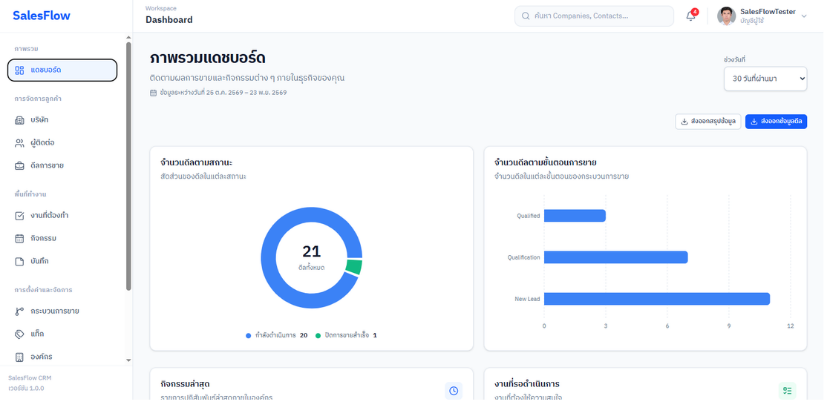

### Deals

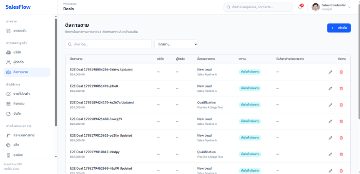

### Sales Pipeline

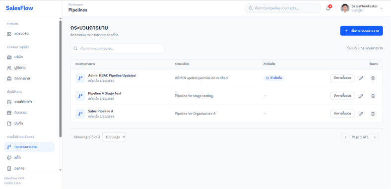

### Contacts

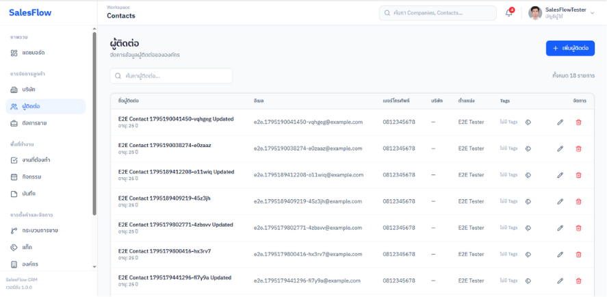

### Companies

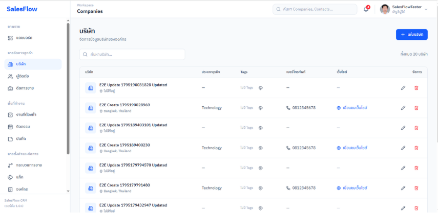

### Organization

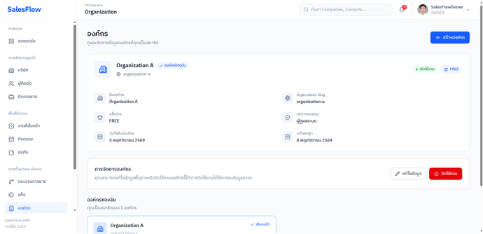

### Members

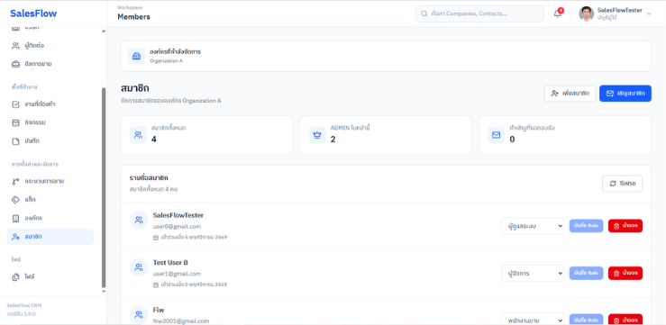

### Tasks

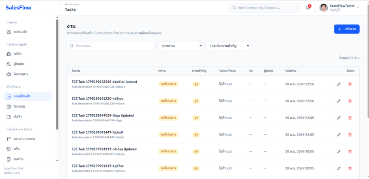

### Activities

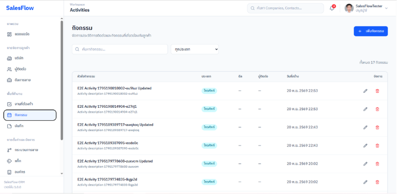

### Notes

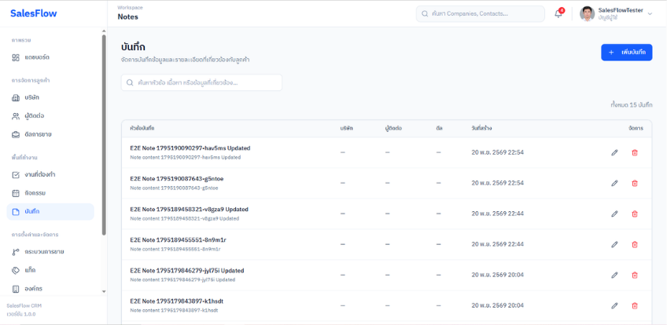

### Notifications

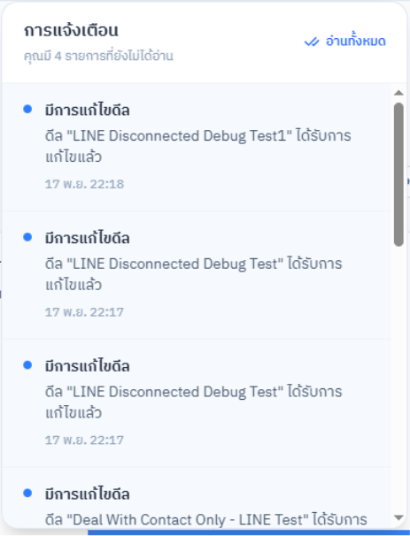

### My Account

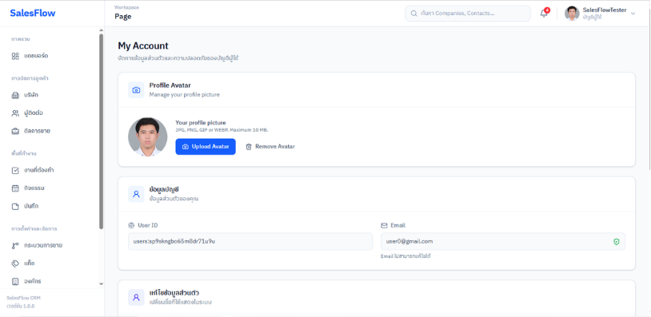

## Technology Stack

| Layer              | Technologies                   |
| ------------------ | ------------------------------ |
| Backend            | Python 3.12, FastAPI, Pydantic |
| Database           | SurrealDB                      |
| Frontend           | React 19, TypeScript           |
| Build Tool         | Vite                           |
| Data Fetching      | TanStack Query, Axios          |
| Forms & Validation | React Hook Form, Zod           |
| Charts             | Recharts                       |
| Styling            | Tailwind CSS                   |
| Backend Testing    | Pytest, HTTPX                  |
| Frontend Testing   | Vitest, React Testing Library  |
| E2E Testing        | Playwright                     |
| CI/CD              | GitHub Actions                 |

## System Architecture

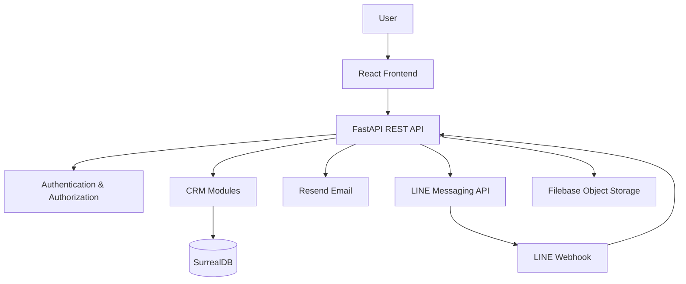

The frontend communicates with the backend through REST APIs. The backend handles authentication, authorization, business logic, and database operations.

Organization-scoped resources are protected by membership and permission checks to maintain data isolation between organizations.

## Project Structure

```text
SalesFlow/
├── backend/
│   ├── app/
│   │   ├── core/
│   │   ├── database/
│   │   ├── modules/
│   │   └── main.py
│   ├── tests/
│   ├── requirements.txt
│   └── requirements-dev.txt
│
├── frontend/
│   ├── public/
│   ├── src/
│   │   ├── api/
│   │   ├── assets/
│   │   ├── components/
│   │   ├── features/
│   │   ├── hooks/
│   │   ├── layouts/
│   │   ├── pages/
│   │   ├── routes/
│   │   ├── styles/
│   │   ├── test/
│   │   ├── types/
│   │   └── utils/
│   ├── package.json
│   └── vite.config.ts
│
└── .github/
    └── workflows/
        ├── backend-ci.yml
        ├── frontend-ci.yml
        └── cd.yml
```

## Getting Started

### Prerequisites

- Python 3.12
- Node.js 24
- npm
- SurrealDB 3.3.5

### 1. Clone the Repository

```bash
git clone https://github.com/fiiw2545/SalesFlow.git
cd SalesFlow
```

### 2. Backend Setup

Navigate to the backend directory:

```bash
cd backend
```

Create and activate a virtual environment:

```bash
python -m venv venv
```

Windows PowerShell:

```powershell
.\venv\Scripts\Activate.ps1
```

Install dependencies:

```bash
pip install -r requirements.txt
pip install -r requirements-dev.txt
```

Create the environment file:

```powershell
Copy-Item .env.example .env
```

Configure the required database, authentication, and integration settings in `.env`.

Start the backend:

```bash
uvicorn app.main:app --reload
```

Backend API: `http://localhost:8000`

API documentation: `http://localhost:8000/docs`

### 3. Frontend Setup

Open another terminal and navigate to the frontend directory:

```bash
cd frontend
npm ci
```

Configure the backend API URL in:

`frontend/public/runtime-config.js`

Example:

```javascript
window.SALESFLOW_CONFIG = {
  API_BASE_URL: "http://localhost:8000",
};
```

Start the frontend:

```bash
npm run dev
```

The frontend development server will display its local URL in the terminal.

## Environment Configuration

The backend uses environment variables for:

- SurrealDB connection settings
- JWT and session security
- Resend email integration
- LINE Messaging API
- Filebase object storage
- Frontend CORS configuration
- Application environment

Refer to `backend/.env.example` for the required variable names.

The frontend API URL is configured through `frontend/public/runtime-config.js`.

**Never commit `.env` files, credentials, API keys, or private secrets to the repository.**

## Testing

### Backend Tests

Run the backend test suite:

```bash
cd backend
python -m pytest
```

### Frontend Unit & Component Tests

```bash
cd frontend
npm run test:run
```

### Frontend End-to-End Tests

```bash
npm run test:e2e
```

### Frontend Build

```bash
npm run build
```

## Testing Results

Latest completed project test results:

| Test Suite                |     Result |
| ------------------------- | ---------: |
| Backend                   | 269 passed |
| Frontend Unit & Component | 415 passed |
| Playwright E2E            |  57 passed |
| Frontend Production Build |     Passed |
| Backend CI                |     Passed |
| Frontend CI               |     Passed |

These results represent the completed QA run and CI checks for this project.

## CI/CD

GitHub Actions is used to automate quality checks and artifact preparation.

- **Backend CI** — Installs dependencies, prepares a test database, and runs backend tests with coverage.
- **Frontend CI** — Runs linting, frontend tests, and production build checks.
- **CD Workflow** — Packages backend and frontend build artifacts for later deployment.

The project includes CI and artifact packaging workflows. Production hosting and deployment are not part of the current project scope.

## Security Considerations

- HttpOnly cookies for authentication tokens
- Refresh token rotation and session revocation
- Role-based authorization
- Organization-level data isolation
- Environment-based configuration
- Database debug endpoints restricted to development and testing environments

## Project Status

**Development and QA completed.**

SalesFlow is maintained as a full-stack CRM portfolio project. Deployment to a production hosting environment is outside the current project scope.

## Author

Developed as a full-stack CRM portfolio project.

GitHub: [https://github.com/fiiw2545](https://github.com/fiiw2545)
